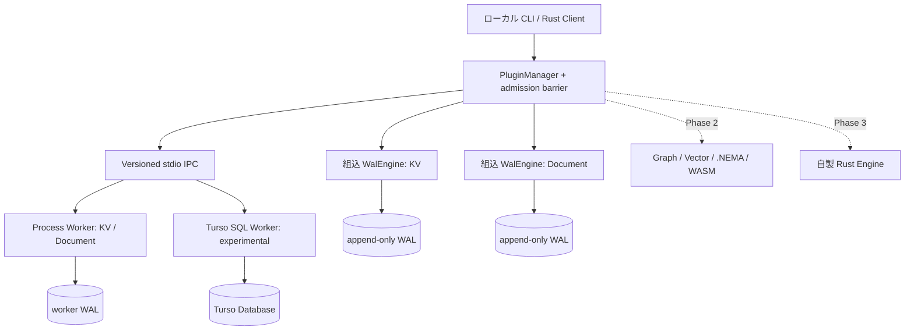
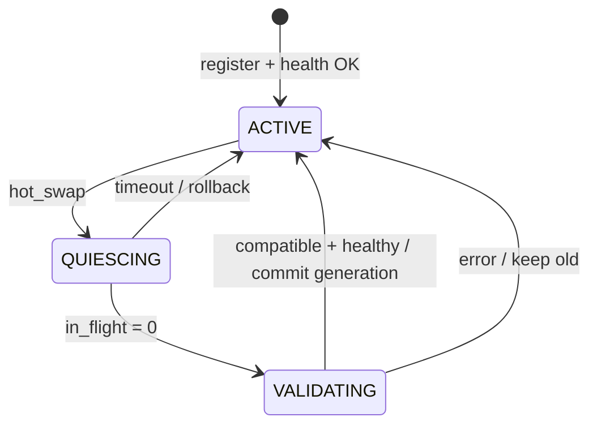

# 02 基本設計書（方式・アーキテクチャ）

文書ID: BSD-001｜版: 0.1.0｜状態: 未承認

## 1. 設計方針
最小 Rust microkernel に `Engine` 契約・`PluginManager`・IPC を置く。モデル処理・保存はプラグインへ。**安全性に必要なルーティング制御は固定内核**とし、信頼境界を横断するプラグインを任意に内核権限へ昇格させない。

## 2. 配置設計
| 配置 | V1 | 理由 |
|---|---|---|
| 組込 crate | lib `polydb` | オフライン・標準ライブラリのみ |
| CLI | `polydb` | 管理操作検証、ローカル専用 |
| Worker | `polydb-worker` | 障害隔離の足場、stdio IPC |
| SQL Worker | `adapters/turso-worker` | Turso 0.8.3 と切り離す |
| 管理状態 | in-memory registry | V1 では復帰時に登録を再実行 |
| ファイル | WAL / `.db` | 管理者指定パス。暗号化なし |

## 3. 動作状態設計
| 状態 | 新規処理 | 操作 | 次状態 |
|---|---|---|---|
| ACTIVE | 受入 | execute | ACTIVE |
| QUIESCING | Busy を返す | `in_flight` が 0 まで待機 | VALIDATING |
| VALIDATING | Busy を返す | 候補生成/health/属性一致 | ACTIVE (新) |
| FAILED | 一時拒否 | 旧インスタンスへ戻す | ACTIVE (旧) |

## 4. IF 方式
- Rust API: `PluginManager::register`, `execute`, `hot_swap_with`, `generation`。
- Engine 契約: `descriptor`, `execute`, `health`。
- Request: Ping、Put/Get/Delete/Scan、SqlExec/SqlQuery。Response: Ack、Value、Items、Text。
- IPC: stdio + little-endian length frame + version + opcode + argument count。
- Manifest: 1 ファイル=1 Worker 起動構成。trusted local 管理者入力のみ。

## 5. データ配置
V1 の `kv` と `document` は別 WAL を前提とし、実装は BTreeMap のメモリ索引を全ログ再生で復元する。LOG の単調増加、compaction 不在、データ損傷時の起動拒否が制約。

## 6. 一貫性境界
各 `WalEngine` はプロセス内 Mutex 直列化と `sync_all` 完了後 ACK を提供するが、完全な ACID トランザクション、複数ファイル atomic commit、MVCC、システム電源障害時の耐久性保証は提供しない。異種エンジン間の分散 ACID は将来設計である。

## 7. 外部連携
V1 にネットワーク・認証・外部公開なし。将来の HTTP/gRPC は authn/authz、rate limit、監査、TLS を実装後にのみ有効化。Google Drive 等の cloud backup は別プラグインとし、不許可データのクラウド流出を防ぐポリシー必須。
