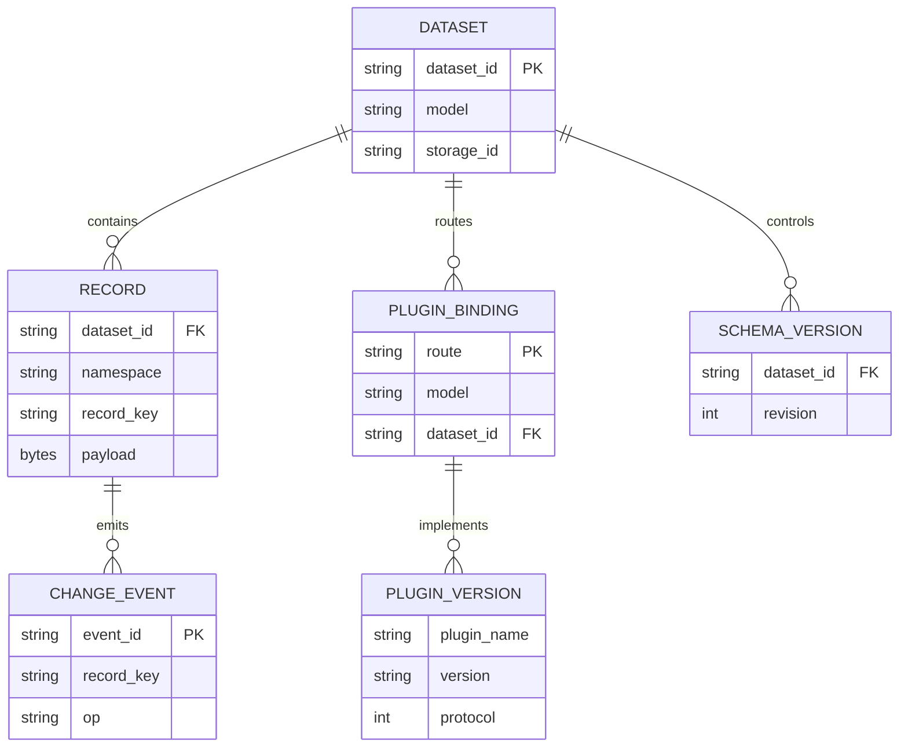

# 04 データ設計書（ER・論理・物理モデル）

文書ID: DAT-001｜版: 0.1.0｜状態: 未承認

## 1. 概念モデル（将来統合 Catalog）

注意: 上記 ER は **V2 の論理設計案**。V1 に Catalog、Schema Version、Change Event の永続 DB テーブルは存在しない。V1 の構成情報はメモリ上、永続データは各 WAL/SQL ファイル。

## 2. V1 物理モデル
| 項目 | 表現 | 保持 |
|---|---|---|
| Routing table | `HashMap<String,Arc<Slot>>` | memory |
| Record index | `BTreeMap<(String,String),Vec<u8>>` | memory (WAL から再生) |
| WAL entry | opcode + namespace + key + raw value | disk |
| Generation | u64 | memory |
| SQL schema | Turso が管理 | Turso DB file |

## 3. ルール
キー一意性は `(namespace,key)` の組である。Delete は tombstone log により再起動後も反映される。スキーマ変更、文書パス検索、Secondary Index、TTL、Graph エッジ、Embedding index は未実装。

## 4. 将来移行契約
V2 で「安定 Dataset ID」「schema version」「plugin physical format version」「migration manifest」「snapshot fence」「restore verification」を定義してからエンジン跨ぎの移行を可能にする。単なる同名 route の付替えを migration とみなさない。
