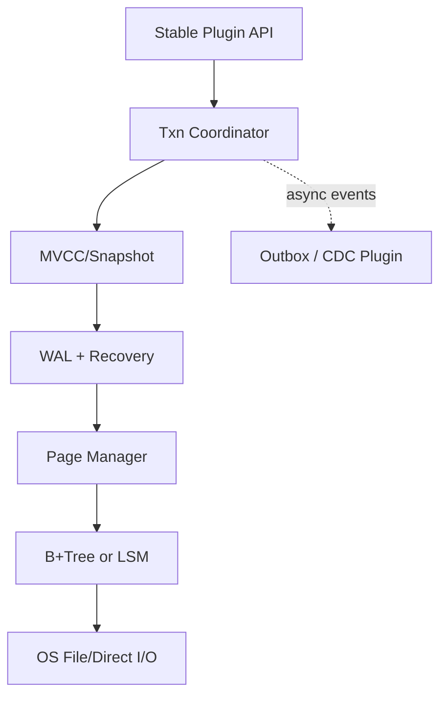

# 15 移行設計・自研 Rust エンジンロードマップ

文書ID: MIG-001｜版: 0.1.0｜状態: 将来構想

## 1. Turso → 自研 Engine の段階設計
① stable API 契約（logical types）→② dataset ID と schema registry→③ snapshot export/import→④ full copy + record count/hash validation→⑤ CDC catch-up→⑥ write fence→⑦ cutover→⑧ rollback window→⑨ audit seal。**V1 はこの移行機構を実装しない**。

## 2. 自研ストレージ構成案

## 3. 差分試験要求
同一操作列を Turso と自研 engine に適用し、結果とエラー区分を比較（受容範囲を明示）。故障注入点: flush 前後、WAL append 途中、checkpoint 途中、再起動 recovery、plugin switch 直前後、index rebuild。SQL 互換の範囲は機能表で宣言する。

## 4. Cross-engine 取引
同一データストア内での multi-model strong ACID と、独立エンジン間の eventual consistency を区別する。初期は Outbox / CDC と冪等 consumer の方がシンプル。2PC 等を採用する場合はクラッシュ時の coordinator recovery と参加者の再接続検証が必要。

## 5. ロールバック原則
不整合データの自動上書きを避ける。スナップショット時点、検証 hash、未反映イベント、切替 generation、監査記録を保持し、operator approval を必須とする。
